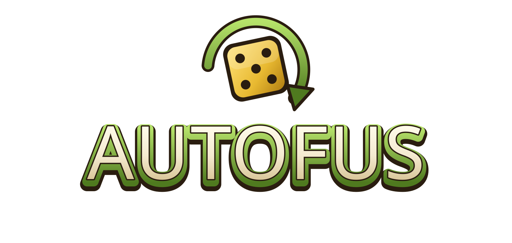

# Autofus

Autobattler dans l'univers de Dofus, qui se joue dans le navigateur : recrute des unités, active leurs synergies, équipe-les d'objets et de reliques, traverse trois actes jusqu'au Kralamour, puis tente le mode infini.

## Comment jouer

- **En ligne :** https://TON-PSEUDO.github.io/NOM-DU-DEPOT/ *(lien à compléter)*
- Aucune installation : un navigateur récent suffit (Chrome, Edge ou Firefox).
- La musique démarre au premier clic.
- La sauvegarde, les réglages et le classement restent dans le navigateur de chaque joueur : rien n'est envoyé sur Internet.

## Contrôles

| Action | Commande |
|---|---|
| Placer ou déplacer une unité | glisser-déposer entre le banc et le plateau |
| Vendre une unité | la glisser sur « Vendre » |
| Équiper un objet | le glisser sur une unité |
| Acheter en boutique | clic (ou glisser l'offre sur une unité / le banc) |
| Lancer le combat | bouton « Combattre », Espace ou Entrée |
| Vitesse du combat | boutons ×1, ×2, ×4 |
| Zoom sur le plateau | molette ; glisser pour se déplacer ; double-clic pour la vue entière |
| Pause | Échap |
| Couper / remettre la musique | M ou bouton haut-parleur |
| Images par seconde | F |
| Menu principal | flèches ← → puis Entrée |

## Mention

Projet de fan non officiel, non commercial, non affilié à Ankama. Dofus et ses éléments sont la propriété d'Ankama.

Ce projet sera retiré sur simple demande d'Ankama.
